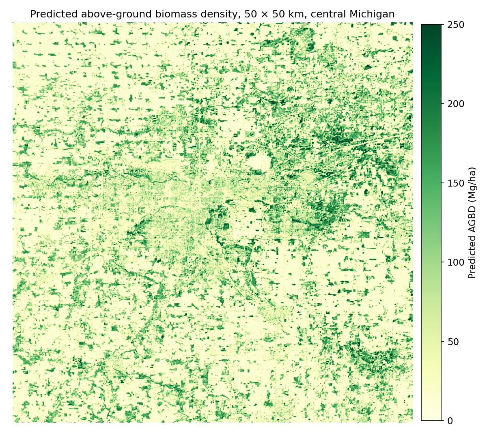
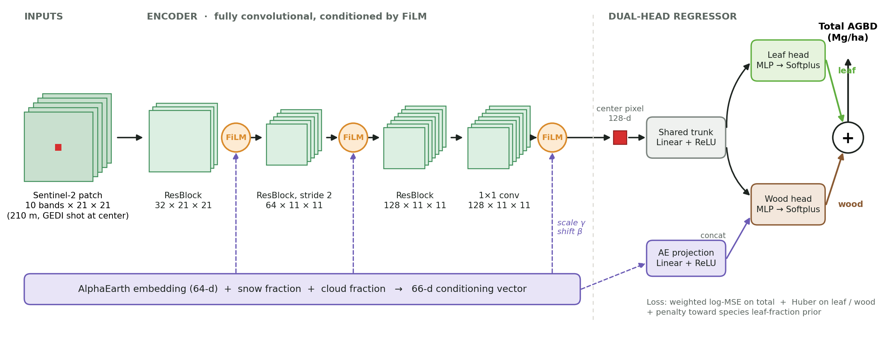

# Forest Biomass Mapping

Mapping above-ground forest biomass density (AGBD) across Michigan at 10 m resolution by learning from sparse
GEDI spaceborne lidar with Sentinel-2 imagery and Google AlphaEarth embeddings, then splitting biomass into
leaf and wood with species-level allometry and phenology.

**Project page:** https://huang-ch.com/portfolio/agbd/



## Highlights

- **61,246 GEDI L4A footprints** (2024–2025) as labels, each paired with a 21 × 21 Sentinel-2 patch (210 m) and a
  64-d AlphaEarth embedding.
- **Fully convolutional CNN with FiLM conditioning.** The AlphaEarth vector modulates the image encoder at three
  stages, and biomass is read from the center pixel, so the same network runs as a dense 10 m sliding-window map.
- **Dual-head variant** predicting leaf and wood biomass separately, with total = leaf + wood.
- **Species-based leaf-fraction map** for about 40 M forest pixels, built from USFS TreeMap 2022, BAAD and Jenkins et al.
  allometry.
- **Phenology analysis:** a harmonic decomposition of a 6-year predicted time series, validated against MODIS LAI
  (r = 0.87).

| Model                                              | RMSE (Mg/ha)   | RMSE ÷ target std | R²            |
| -------------------------------------------------- | -------------- | ------------------ | -------------- |
| Predict the mean                                   | 78.7           | 1.00               | 0.00           |
| Random forest (canopy height, SRTM, Daymet, NLCD)* | 23.6           | 0.58               | 0.67           |
| CNN, S2 + AlphaEarth, single head                  | 37.6–39.7     | 0.48–0.50         | 0.75–0.77     |
| **CNN, S2 + AlphaEarth, dual head**          | **37.1** | **0.47**     | **0.78** |

\*Scored on an earlier, smaller subset with a narrower biomass range (target std ≈ 41 vs. ≈ 79 Mg/ha), so compare
R² or RMSE ÷ std, not raw RMSE. All CNN numbers come from a random 70/15/15 split of footprints. Nearby GEDI shots have
overlapping patches, so a spatially blocked split would give a more conservative estimate (see
[Limitations](#limitations)).



## Repository layout

```
docs/          Project page (GitHub Pages), figures, editable architecture diagram (architecture.drawio)
data_prep/     Steps 01–07: reproject and mosaic rasters, extract GEDI shots, cut patches, align AlphaEarth
model/         Dataset, networks, training loop, evaluation entry point, wall-to-wall inference
leaf_prior/    TreeMap + BAAD + Jenkins leaf-fraction map, harmonic decomposition, MODIS LAI validation
baselines/     Random-forest baseline
weights/       Trained checkpoints and their AlphaEarth normalization stats
```

| File                                     | Purpose                                                                                     |
| ---------------------------------------- | ------------------------------------------------------------------------------------------- |
| `model/network.py`                     | `S2EncoderFCN_ResFiLM` encoder, single-head `AGBDNet` and `AGBDNet_DualHead`          |
| `model/dataset.py`                     | Loads S2/SCL patches, AlphaEarth vectors, cloud/snow fractions, NLCD forest type, GEDI date |
| `model/train.py`                       | Training loop; dual-head loss (weighted log-MSE + leaf/wood Huber + leaf-fraction prior)    |
| `model/main.py`                        | Builds the split, trains or evaluates, writes metrics and plots                             |
| `model/inference_map.py`               | Tiled sliding-window prediction over full scenes, leaf/wood maps from the prior             |
| `leaf_prior/prepare_leaf_prior.py`     | Per-pixel leaf-fraction GeoTIFF for Michigan                                                |
| `leaf_prior/harmonic_decomposition.py` | Two-term harmonic fit of the AGBD time series                                               |
| `leaf_prior/validate_lai.py`           | Comparison with MODIS MCD15A2H LAI                                                          |

## Weights

| File                      | Network                      | Notes                                                                                |
| ------------------------- | ---------------------------- | ------------------------------------------------------------------------------------ |
| `weights/dualhead.pt`   | `network.AGBDNet_DualHead` | Used for the reported test metrics                                                   |
| `weights/singlehead.pt` | `network.AGBDNet`          | Outputs log-AGBD (apply `exp`). Used by `inference_map.py` for wall-to-wall maps |

Each `.pt` has a matching `.npz` with the AlphaEarth mean and std computed on the training split. Inference
must use the same `.npz` as its checkpoint.

```python
import numpy as np, torch
from network import S2EncoderFCN_ResFiLM, AGBDNet_DualHead

stats = np.load("../weights/dualhead.npz")
model = AGBDNet_DualHead(S2EncoderFCN_ResFiLM(in_channels=10, embed_dim=128, ae_dim=66), embed_dim=128, ae_dim=66)
model.load_state_dict(torch.load("../weights/dualhead.pt", map_location="cpu"))
model.eval()
# s2: [B, 10, 21, 21] Sentinel-2 L2A digital numbers
# ae: [B, 66] = (AlphaEarth - stats["alpha_mean"]) / stats["alpha_std"], then snow fraction, cloud fraction
out = model(s2, ae)   # {"leaf", "wood", "total"} in Mg/ha
```

## Getting started

```bash
python -m venv .venv
.venv\Scripts\activate          # Windows; use `source .venv/bin/activate` on macOS/Linux
pip install -r requirements.txt
```

PyTorch is pinned to a CUDA 12.8 build. If you have a different GPU setup or no GPU, install the matching wheel from
https://pytorch.org/get-started/locally/ first.

No data is included. [DATA.md](DATA.md) lists every source, how to download it, and the order to run the
preparation scripts. To evaluate the bundled weights once the patches are built:

```bash
cd model
python main.py          # eval_only=True by default; set it to False to retrain
```

## Limitations

- **Spatial leakage in the split.** GEDI shots are about 60 m apart along a track, so a random split puts overlapping
  210 m patches in train and test. Held-out tracks or spatial blocks would give a fairer estimate.
- **Skewed targets.** About half the shots are below 20 Mg/ha, so R² partly reflects forest vs. non-forest. Forest-only
  metrics would be more informative.
- **Leaf/wood split is prior-driven.** The dual head's leaf and wood targets are GEDI total × a prior fraction, so the
  split comes from the prior rather than being learned from the images. The seasonal swing in predicted AGBD (about
  ±40 Mg/ha) tracks MODIS LAI closely, but it is larger than real foliage mass, so it is best read as a canopy-greenness
  effect.
- **One AlphaEarth year.** The 2024 annual embedding is used for 2025 shots and for every inference date.
- **Research code.** Scripts were written for one machine. Paths and the `season` setting are set at the top of
  each script and need editing before you run them.

## Data sources and citations

- Dubayah, R. et al. *GEDI L4A Footprint Level Aboveground Biomass Density, Version 2.1.* ORNL DAAC. doi:10.3334/ORNLDAAC/2056
- Copernicus Sentinel-2 Level-2A, European Space Agency.
- Brown, C. F. et al. (2025). *AlphaEarth Foundations.* Google DeepMind; Earth Engine `GOOGLE/SATELLITE_EMBEDDING/V1/ANNUAL`.
- U.S. Geological Survey. *Annual National Land Cover Database (NLCD), Collection 1.*
- Riley, K. L. et al. *TreeMap 2022 CONUS.* USDA Forest Service Research Data Archive.
- Falster, D. S. et al. (2015). BAAD: a Biomass And Allometry Database for woody plants. *Ecology* 96:1445.
- Jenkins, J. C. et al. (2003). National-scale biomass estimators for United States tree species. *Forest Science* 49(1):12–35.
- Myneni, R., Knyazikhin, Y., Park, T. *MCD15A2H MODIS LAI/FPAR 8-Day L4 Global 500 m, v061.* NASA LP DAAC.
- Lang, N. et al. (2023). A high-resolution canopy height model of the Earth. *Nature Ecology & Evolution*.
- NASA SRTM v3 (SRTMGL1); Thornton, M. M. et al. *Daymet Version 4*, ORNL DAAC.

## Author

Andrew Huang
